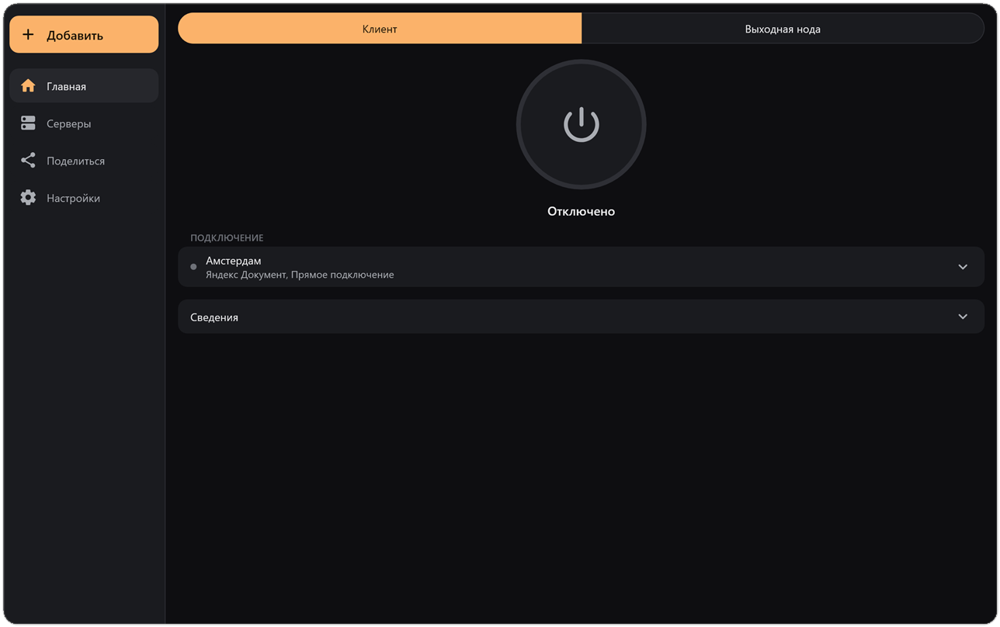
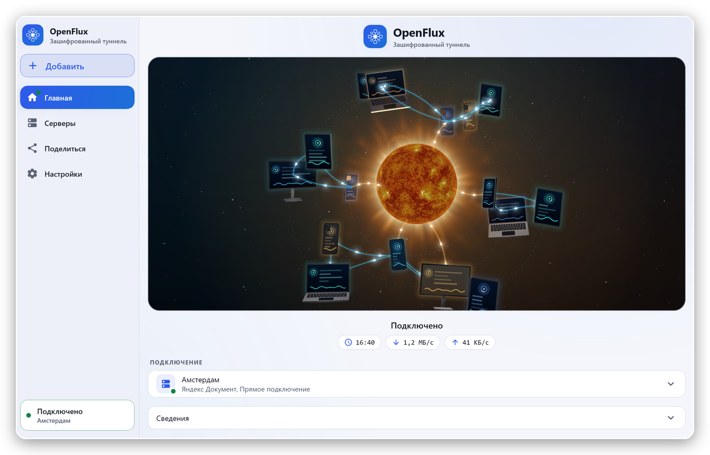
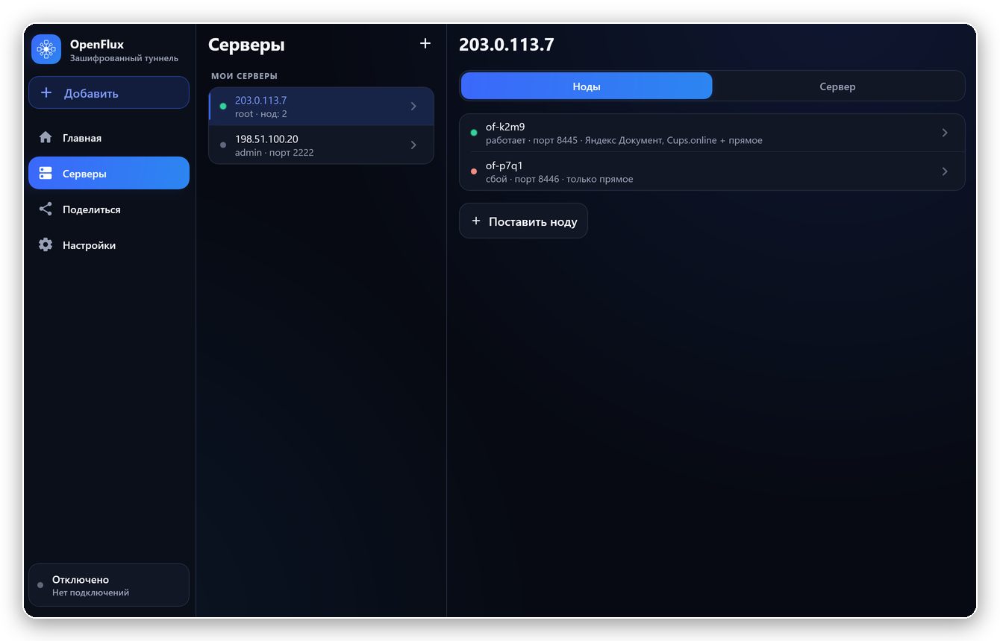
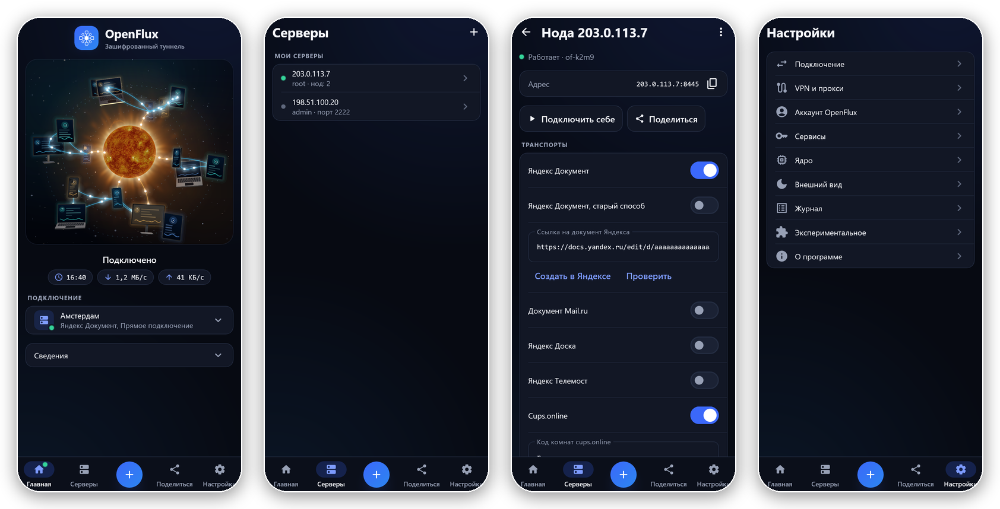

<p align="center">
  
</p>

<h1 align="center">OpenFluxDesktop</h1>

<p align="center">
  The OpenFlux client for Windows, macOS and Linux.<br>
  A tunnel that rides on ordinary web services, with automatic failover between them.
</p>

<p align="center">
  <a href="../../releases/latest"></a>
  <a href="LICENSE"></a>
  
</p>

<p align="center">
  <b>English</b> · <a href="README.ru.md">Русский</a>
</p>

<p align="center">
  <a href="https://github.com/OpenFluxTeam/OpenFlux">Core</a> · <a href="https://github.com/OpenFluxTeam/OpenFluxDesktop">Desktop</a> · <a href="https://github.com/OpenFluxTeam/OpenFluxAndroid">Android</a> · <a href="https://testflight.apple.com/join/BwnAcdus">iOS (TestFlight; the App Store release is coming)</a>
</p>

<p align="center">
  
</p>

## What it is

OpenFluxDesktop is the desktop app of [OpenFlux](https://github.com/OpenFluxTeam/OpenFlux). It runs the OpenFlux core as a separate process and gives it a window, a tray icon and a setup wizard. Traffic goes through a **transport**: a document on a web service (Yandex, Mail.ru, cups.online, Avito, Telemost, MAX) or a plain TCP connection to your own node. A profile can hold several transports; the app switches between them by priority when one stops working.

## The switch

<p align="center">
  
</p>

The connect button is a small universe. While the app is off, the Moon turns slowly in the middle and phones, tablets, laptops and monitors drift round it with their screens dark. Press it: while the connection is being set up, the Moon's crust cracks with fire; once it is up, the Moon burns into the Sun, the screens light up as its light reaches them, the devices settle into orbits, and links of light join them to each other and to the Sun, with traffic running along them, faster when the connection carries more. Disconnect and it all plays back; a failed connection flares red. The Moon and the Sun are real: NASA's LRO map of the Moon and the Sun's surface seen by the Solar Dynamics Observatory, drawn by a shader on the GPU.

<p align="center">
  
</p>

## Features

- **A new look.** Deep navy and one blue accent, as in 2.x, with soft light and motion everywhere; dark and light themes.
- **Full tunnel or a proxy.** All of the computer's traffic through Wintun (Windows) or utun (macOS), or a local SOCKS5 and HTTP proxy. Windows can also point the system proxy at it while connected.
- **Several transports in one profile**, each with a priority and the network it may use. When the best one fails, the next takes over.
- **Encryption.** AES-256-GCM end to end with a key you set; a profile with a key hides the traffic from the service that carries it.
- **A node in a few clicks.** The wizard installs an exit node on your server over SSH, or sets one up on ordinary PHP hosting with no server at all. The node updates itself and rolls back if an update does not start.
- **Share by link or QR.** An `openflux://` link carries a whole profile.
- **A built-in browser** for the checks some services ask for (SmartCaptcha, a login wall).
- **Your own node on this computer.** The *Exit node* mode turns the app into a node that others connect through.
- **Updates from GitHub releases**, checked against the release's `SHA256SUMS.txt`, installed only when you agree.

<p align="center">
  
  
</p>

<!-- team:start -->
## What is new in the current release

The release **3.9** carries the OpenFlux core 0.14 (unchanged since 3.8).

- **A new look.** The 2.x palette is back and richer: deep navy, one blue accent with soft light, motion on every control, the side column with the logo and the connection's card.
- **The switch.** Home's button is the Moon that burns into the Sun, with the devices round it waking and joining the network: see [The switch](#the-switch).
- From 3.8: **direct first** (a plain TCP connection to the node ahead of the documents while it is alive), **speed** work (large packets, pooled buffers, Reno on direct streams), **stripe groups** in the core, and **a restarted node is taken over at once**.

The full list is in [CHANGELOG.md](CHANGELOG.md).
<!-- team:end -->

## Install

Download the file for your system from the [releases page](../../releases/latest).

| System | File |
|---|---|
| Windows 10/11 x64 | `.msi` or `-setup.exe` to install, `-portable.zip` to run without installing |
| Linux x64 | `.deb` (Debian, Ubuntu, Mint) or `.tar.gz` |
| macOS | `-macos-arm64.dmg` (Apple silicon) or `-macos-x64.dmg` (Intel) |

- The macOS builds are not signed: the first time, open the app with a right click → *Open*.
- Full-tunnel mode needs administrator rights (a UAC prompt on Windows, the password on macOS). On Linux, point programs at the SOCKS5 proxy `127.0.0.1:1080` or the HTTP proxy `127.0.0.1:1081`.
- The built-in browser (about 230 MB) is downloaded the first time it is needed.

## Build from source

Needs JDK 17 and Go (or Docker, to build without Go).

```bash
git clone --recurse-submodules https://github.com/OpenFluxTeam/OpenFluxDesktop.git
cd OpenFluxDesktop
./gradlew :desktopApp:run          # run; builds the core for this machine on the first run
```

Already cloned without `--recurse-submodules`? Run `git submodule update --init --recursive`.

| Command | What it does |
|---|---|
| `./gradlew :desktopApp:run` | run the app |
| `scripts/build-core.sh` | build the core by hand from the `OpenFlux/` submodule |
| `./gradlew :shared:jvmTest` | run the tests |
| `./gradlew -PwindowsPackage=true :desktopApp:packageMsi` | Windows `.msi` (also `packageExe`) |
| `./gradlew :desktopApp:packageDmg` | macOS `.dmg` |
| `./gradlew :desktopApp:packageDeb` | Linux `.deb` (needs `fakeroot`) |

The core binaries are not committed to git: `run` and `package*` build the one for this machine into `desktopApp/resources/<windows|macos|linux>` if it is not there. `-PskipCore=true` runs the app without a core; *Settings → Core* then takes a file of your own.

## Structure

```
desktopApp/   Window, tray, shortcuts, packaging, icons
shared/       Submodule: models, service interfaces, design system, screens
  jvmMain/
    core/     Core process launch, IPC status, Yandex checks
    node/     The node wizard (core --node-wizard over stdin/stdout)
    web/      The built-in browser: off-screen KCEF, a proxy router, a log
    platform/ Windows system proxy (WinInet), administrator rights
    data/     Settings and profile storage
OpenFlux/     Submodule: the core (CLI), started as a subprocess
scripts/      build-core.sh
```

The same screens run on Android in [OpenFluxAndroid](https://github.com/OpenFluxTeam/OpenFluxAndroid); both use the module [OpenFluxClientShared](https://github.com/OpenFluxTeam/OpenFluxClientShared).

<p align="center">
  
</p>

## Credits

- **[meepo161](https://github.com/meepo161)** — author of [OpenFluxClient](https://github.com/meepo161/OpenFluxClient), the source of this app's UI and logic (`desktopApp/`, `shared/`): multi-transport sessions with failover, encryption, the built-in browser and check flow, the node wizard and the Compose design system. Thank you!
- **[p1neappleXpress](https://github.com/p1neappleXpress)** — author of the [OpenFlux](https://github.com/p1neappleXpress/OpenFlux) core this app bundles: the tunnel, the transports and the negotiation protocol.

The previous, independent desktop client that lived in this repository is kept at the [`legacy-native-app`](../../tree/legacy-native-app) tag.

## License

GNU General Public License v3.0 or later — see [LICENSE](LICENSE).
